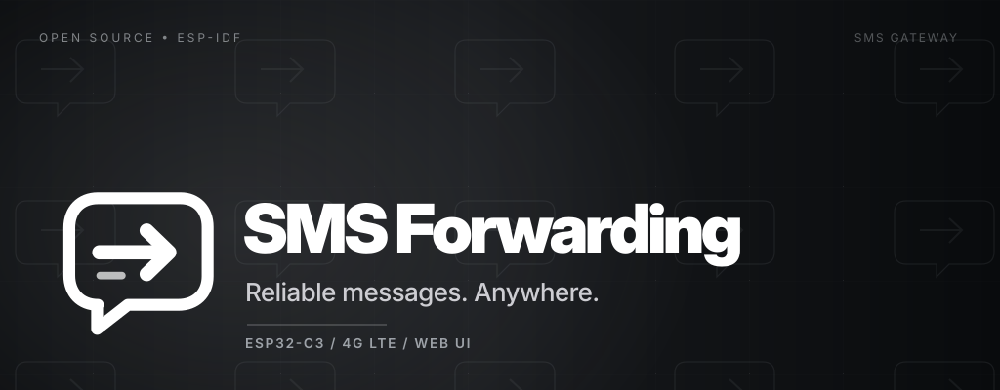

> **本分支：ESP32-C3 双 ML307C 候选版，尚未通过完整实机验收。** 固定 ESP-IDF 5.5.5，上游提交记录在 `upstream.lock.json`。请先阅读 [双卡接线、构建与安装指南](dev_doc/upstream_dual_modem.md)、[上游更新提醒与批准](dev_doc/upstream_sync.md) 和 [5.5.5 构建验证记录](dev_doc/idf555_rebuild_report.md)。下方保留上游说明；单模组固件与原烧录说明不适用于本分支首次安装。



<h1>
  <picture>
    <source media="(prefers-color-scheme: dark)" srcset="assets/brand/logo_white.svg">
    
  </picture>
  SMS Forwarding
</h1>

<p align="center">
  <a href="https://github.com/Elon-Smith/sms_forwarding/actions/workflows/build.yml"></a>
  <a href="LICENSE"></a>
  <a href="https://linux.do"></a>
</p>

基于 **ESP32-C3 + ML307R 4G 模组** 的短信转发器。支持 SIM / eSIM、中文与长短信，通过 WiFi 转发到邮件和最多 **5 个推送通道**，并提供浏览器配置与维护界面。

## 工作原理



短信由当前使用的 SIM / eSIM 接收，经模组 UART/AT 交给短信转发器解码、合并与去重，再经过黑名单与规则处理，由后台队列通过 WiFi 转发。图中列出全部 **10 种推送方式**，最多同时启用 **5 个推送通道**，邮件可同时启用。红色虚线表示黑名单命中或规则丢弃；未命中规则时转发到全部已启用通道。

**Web UI** 支持在线查看与发送短信、复制验证码、配置定时任务和转发规则，并提供网络状态、日志、备份与 OTA。通过激活码可在线下载写入 eSIM Profile，再启用或切换配置。

## 主要功能

- **短信与来电**：PDU 中文解码、长短信合并、通知与轮询补收、去重、收件箱、验证码复制、手动发短信与来电通知。
- **转发与过滤**：SMTP、Bark、Telegram、Gotify、钉钉、飞书、PushPlus、Server酱及自定义 HTTP；按发件人、关键词或正则分流，支持黑名单与失败重试。
- **定时与保号**：SIM 保号、心跳、每日重启、短信组件体检及最多 6 个自定义任务。
- **eSIM 管理**：查看、下载与启用 Profile，支持定时任务切卡；具体能力取决于模组、卡片和运营商支持。
- **网页维护**：WiFi 配网、设备与信号状态、AT 终端、系统日志、配置备份和 OTA 升级。

## 快速上手

### 1. 硬件接线

默认 UART 为 115200，适用于 ESP32-C3 Super Mini 与 ML307x-DC 开发板：

| ESP32-C3 | ML307x-DC |
| --- | --- |
| GPIO5 | EN |
| GPIO3（TX） | RX |
| GPIO4（RX） | TX |
| GND | GND |
| 5V | VCC |

### 2. 下载与刷写

在 [Releases](https://github.com/MineSunshineone/sms_forwarding/releases) 下载固件：

| 固件 | 用途 |
| --- | --- |
| `sms_forwarder_full_v*.bin` | 首次刷机或整机重刷，串口写入地址 **`0x0`** |
| `sms_forwarder_ota_v*.bin` | 已运行设备在 **系统设置 → 固件升级 (OTA)** 上传 |

首次刷机可使用 [Flash Download Tool](https://docs.espressif.com/projects/esp-test-tools/en/latest/esp32c3/production_stage/tools/flash_download_tool.html) 或 [ESP Launchpad](https://espressif.github.io/esp-launchpad/)。**完整包与 OTA 包不能混用。** [查看详细刷写步骤](dev_doc/usage_guide.md#固件下载与刷写)。

### 3. 配网与配置转发

1. 首次启动时连接热点 `SMS-Forwarder-XXXX`，访问 `http://192.168.1.1` 配置 WiFi，可同时设置设备名称（mDNS）。
2. 设备接入路由器后，通过设备 IP 或 `http://<设备名称>.local` 进入控制台，默认地址为 `http://sms.local`。
3. 默认账号为 `admin` / `admin123`，首次使用请修改密码。
4. 在 **转发设置** 添加通道或邮件配置，保存并测试；需要分流时再添加规则。

## 开发与构建

仅支持原生 **ESP-IDF 5.5.5**，目标芯片 ESP32-C3，默认 Flash 为 4 MB。Windows 脚本通过 `IDF_PATH` / `IDF_TOOLS_PATH` 指定独立 SDK 和工具目录，不依赖固定盘符。

```powershell
# 修改 Web UI 后先重新生成静态资源
python tools\build_web_assets.py
python tools\build_web_assets.py --check

# 编译、烧录、查看日志（COM5 按实际串口替换）
powershell -ExecutionPolicy Bypass -File tools\idf.ps1 build
powershell -ExecutionPolicy Bypass -File tools\idf.ps1 flash -Port COM5
powershell -ExecutionPolicy Bypass -File tools\idf.ps1 monitor -Port COM5
```

构建产物位于 `build/idf5.5.5`；CI 使用固定的 ESP-IDF 5.5.5 镜像。可编辑的前端源文件在 `code/web_src/`，`code/web_assets.*` 为生成文件。

## 文档

- [使用与开发指南](dev_doc/usage_guide.md)：功能说明、刷写、Bark 配置、保号与短信体检、分区和验证记录。
- [架构与数据流](dev_doc/architecture.md) · [组件职责](dev_doc/module_details.md) · [接口参考](dev_doc/api_reference.md)。
- [工程约定](AGENTS.md)。

## 致谢

感谢 [LINUX DO](https://linux.do) 社区提供交流与灵感。项目采用 [MIT License](LICENSE)。
